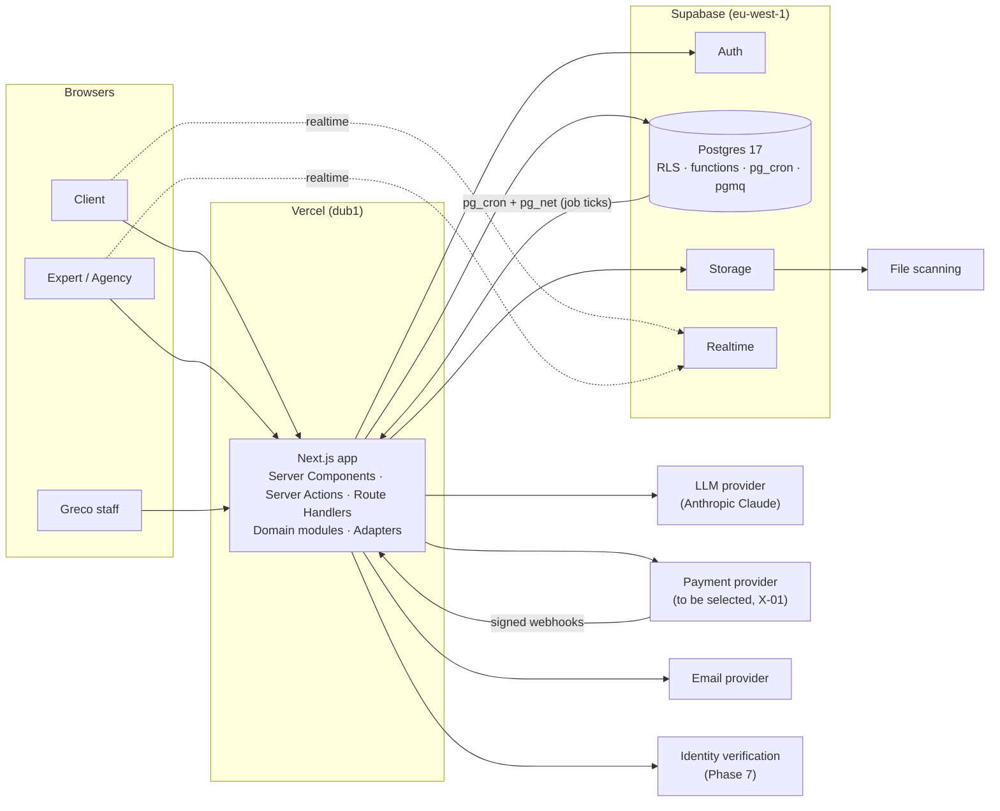

# Greco — System Architecture

**Status:** Approved by the product owner on 2026-11-01. Phase 2 (foundation) implemented: Next.js 16.4 with Cache Components, `src/proxy.ts` for session refresh and locale routing, CSP without nonces (see SECURITY.md §5), RLS helper functions in the `app` schema.
**Last updated:** 2026-11-01

Related documents: [DATABASE_SCHEMA.md](DATABASE_SCHEMA.md) · [PAYMENT_ARCHITECTURE.md](PAYMENT_ARCHITECTURE.md) · [SECURITY.md](SECURITY.md) · [docs/AI_DISCOVERY.md](docs/AI_DISCOVERY.md) · [docs/USER_JOURNEYS.md](docs/USER_JOURNEYS.md) · [docs/DESIGN_SYSTEM.md](docs/DESIGN_SYSTEM.md) · [IMPLEMENTATION_PLAN.md](IMPLEMENTATION_PLAN.md) · [PRODUCT_DECISIONS.md](PRODUCT_DECISIONS.md)

---

## 1. What Greco is

Greco is a two-sided marketplace for AI services. **Clients** (individuals, startups, businesses) find, compare, hire and pay **experts** (freelancers and agencies). Three things set it apart from a generic freelance site:

1. **AI Discovery.** Clients who don't know what they need describe their problem in plain language. The assistant asks a few focused questions, explains possible approaches without jargon, writes a structured project brief and recommends real experts from Greco's catalog, explaining each match and labelling what is verified versus self-reported.
2. **Trust by design.** Verification badges only appear for completed checks. Portfolio items show where they come from (self-reported, completed on Greco, verified by Greco). Reviews come only from completed orders.
3. **Protected transactions.** Payment is upfront (fully or as a deposit plus balance) through a regulated payment provider. Delivery, revisions, cancellations and disputes follow a structured, auditable process.

Direct search and category browsing always work without the assistant.

**State of the repository (2026-11-01):** empty Git repository. Supabase project `Greco` (ref `xubhljmpnjkpfyeuqtxl`, eu-west-1, Postgres 17) exists with an empty `public` schema and no migrations.

---

## 2. Architectural principles

1. **One source of truth.** Postgres holds all marketplace data. Search and AI Discovery read from the same data through the same functions.
2. **Server-side authorization everywhere.** UI checks are only for convenience. Every write is authorized on the server. Row Level Security (RLS) is a second layer, not the only one.
3. **Money is special.** Integer minor units, immutable snapshots of agreed terms, an append-only ledger, idempotent webhook handling, and state machines enforced in the database.
4. **Swappable providers.** Payments, payouts, LLM, email, identity verification, file scanning and search engine are behind adapters.
5. **Three separate lifecycles** for an order: fulfilment, payment and payout.
6. **Provider-side data is keyed by `provider_id`,** not `user_id`, so agency team seats can be added later.
7. **Modular monolith.** One Next.js application with strict module boundaries, not microservices.
8. **Internationalization-ready** from the first line of UI code.
9. **Everything sensitive is auditable.**
10. **Honest data.** Nothing presented as verified unless a verification record says so. The AI never invents facts about experts.

---

## 3. Technology stack

| Concern | Choice | Notes and trade-offs |
|---|---|---|
| Framework | **Next.js** (App Router, latest stable at Phase 2), **React**, **TypeScript** strict | Server Components for fast public pages and SEO. Server Actions and Route Handlers for writes. |
| Styling and components | **Tailwind CSS v4**, **shadcn/ui** (Radix primitives) | Components are copied into the repo and owned, so they can be fully restyled away from the default look. |
| Validation | **Zod** at every boundary (forms, server actions, route handlers, LLM outputs, webhook payloads) | One schema shared by client and server. |
| Database | **Supabase Postgres 17** | Extensions: `pg_trgm`, `unaccent`, `ltree`, `citext`, `pgmq`, `pg_cron`, `pg_net`, `pgtap`, `moddatetime`. Later: `vector` (pgvector 0.8). All available on the existing project. |
| Auth | **Supabase Auth** via `@supabase/ssr` (cookie sessions) | Email + password, Google OAuth, optional LinkedIn (OIDC) for experts, TOTP MFA (mandatory for staff). Server code verifies the user with `getUser()`/`getClaims()`, never by trusting the cookie session alone. |
| Files | **Supabase Storage** | Public bucket for public media. Private buckets for attachments and deliverables. Signed URLs. Resumable uploads for large deliverables. |
| Realtime | **Supabase Realtime** (private Broadcast channels authorized by RLS) | Messages, notifications, order timeline updates. |
| Data access | **supabase-js** with generated types, plus **Postgres functions** for transactional state changes | See §7. |
| Background work | **Outbox table + pgmq + pg_cron** calling protected job endpoints | No extra job infrastructure at launch. Inngest or Trigger.dev only if workflows outgrow this. |
| LLM | **Anthropic Claude** through `@anthropic-ai/sdk`, behind an `LlmProvider` interface. Default model `claude-opus-5-5`. | Provider-independent by design. See [docs/AI_DISCOVERY.md](docs/AI_DISCOVERY.md). |
| Embeddings (later) | Behind an `EmbeddingProvider` interface. Vendor chosen when semantic search is switched on. | Not needed at launch (E-12). |
| Payments | `PaymentProvider` + `PayoutProvider` interfaces. Sandbox adapter during development. **Production PSP undecided (X-01).** | See [PAYMENT_ARCHITECTURE.md](PAYMENT_ARCHITECTURE.md). |
| i18n | **next-intl** | `[locale]` segment, `as-needed` prefix. |
| Email | Resend or Postmark (A-25), behind an `EmailProvider` interface | Needed from Phase 2 for auth emails (Supabase SMTP override). |
| Bot protection | Cloudflare Turnstile | Signup, guest AI Discovery, report forms. |
| Hosting | **Vercel**, functions pinned to `dub1` (next to Supabase eu-west-1) | Preview deployments per PR. |
| Observability | **Sentry** (errors, performance), structured JSON logs with request IDs, LLM usage table | PII scrubbing configured. |
| Testing | Vitest, pgTAP (`supabase test db`), Playwright, axe-core | See §17. |
| Package manager | pnpm | Lockfile committed. |

**Deliberately not used at launch:** separate search engine (Typesense, Meilisearch, Algolia), Redis, GraphQL, a separate vector database, microservices, an ORM schema layer. Each has a defined "add it when" trigger in this document.

**ORM trade-off (E-03, E-04).** Drizzle or Prisma would give TypeScript-native schemas and transactions. But Greco's critical logic is RLS policies, triggers and state-machine functions, which are SQL anyway. Keeping SQL migrations as the single source avoids two schema definitions drifting apart, and enforcing money rules in Postgres protects data even if application code has a bug. The cost is more PL/pgSQL, which we contain by keeping functions small, focused on one transition, and covered by pgTAP tests.

---

## 4. System context



---

## 5. Domain modules

Each module lives in `src/server/modules/<module>/` and owns its tables, validation schemas, policies (authorization rules) and service functions. Modules call each other only through their public service functions, never by querying each other's tables directly.

| Module | Responsibility | Main tables |
|---|---|---|
| `identity` | Accounts, roles, role switching, staff roles, legal acceptances, deletion and export | `profiles`, `user_roles`, `staff_roles`, `legal_*`, `account_*_requests` |
| `clients` | Client profiles and onboarding | `client_profiles` |
| `providers` | Expert and agency profiles, languages, links, stats | `providers`, `provider_*` |
| `taxonomy` | Categories (hierarchy), skills, technologies, industries, use cases, synonyms | `categories`, `category_*`, `taxonomy_*` |
| `catalog` | Service listings, packages, add-ons, requirements, FAQs, media, listing moderation | `service_*` |
| `portfolio` | Portfolio items and case studies with provenance | `portfolio_*` |
| `search` | Search index, query functions, ranking, saved searches | `search_documents`, `saved_searches` |
| `discovery` | AI Discovery sessions, briefs, recommendations, quotas | `discovery_*`, `project_briefs*` |
| `projects` | Custom projects, invitations, proposals | `projects`, `project_*`, `proposals*` |
| `offers` | Immutable purchase terms (package checkout, custom offers, accepted proposals) | `offers`, `offer_*` |
| `orders` | Order lifecycle, milestones, requirements, deliveries, revisions, amendments, timeline | `orders`, `order_*` |
| `payments` | Collection through the PSP, installments, refunds, chargebacks, webhooks | `payments`, `refunds`, `payment_disputes`, `psp_webhook_events` |
| `payouts` | Payout accounts (KYC status), earnings, payouts | `payout_accounts`, `provider_earnings`, `payouts` |
| `ledger` | Double-entry records, balances, reconciliation | `ledger_*`, `reconciliation_*` |
| `resolution` | Cancellations, refund requests, disputes, admin decisions | `resolution_cases`, `resolution_case_events` |
| `reviews` | Verified reviews, responses, rating dimensions | `reviews`, `review_*` |
| `verification` | Verification types, requests, granted verifications, badges | `verification_*`, `verifications` |
| `messaging` | Conversations, messages, attachments, blocks, contact-policy checks | `conversations`, `conversation_participants`, `messages`, `message_attachments`, `user_blocks` |
| `notifications` | In-app notifications, preferences, delivery channels | `notifications`, `notification_*` |
| `saved` | Saved experts, services, categories | `saved_*` |
| `trust_safety` | Reports, moderation actions, statements of reasons, appeals | `content_reports`, `moderation_actions` |
| `platform` | Settings, commission policies, feature flags, country allow-list | `platform_settings`, `commission_policies`, `feature_flags`, `countries` |
| `files` | File metadata, scan status, signed URL issuing | `file_objects` |
| `analytics` | First-party events and KPI views | `analytics_events`, KPI views |
| `audit` | Append-only audit log | `audit_logs` |

---

## 6. Request flow and layering

```
Browser
  │  (React Server Components render reads; forms call Server Actions)
  ▼
src/app/**                    Route segments, layouts, pages, Server Actions, Route Handlers
  │  - parse + validate input (Zod)
  │  - resolve session (getUser/getClaims), enforce route-level guard
  ▼
src/server/modules/<m>/service.ts     Domain logic and authorization policies
  │  - capability + relationship + state checks
  │  - calls repository or DB function
  ▼
src/server/modules/<m>/repository.ts  supabase-js with the USER's JWT (RLS applies)
  │                                   or rpc('<transition_function>') for multi-step changes
  ▼
Postgres                              RLS · SECURITY DEFINER functions · constraints · triggers
                                      writes outbox event in the same transaction
  ▼
Jobs (src/server/privileged/jobs)     process outbox → notifications, email, search reindex
```

- **Reads** in Server Components use the user-scoped Supabase client, so RLS limits what is returned. Public pages (listings, profiles, categories) read from public views and are cached, with revalidation triggered by outbox events.
- **Writes** go through Server Actions or Route Handlers. The browser never writes to tables directly, apart from Storage uploads to pre-authorized paths.
- **Privileged code** (`src/server/privileged/**`) is the only place the secret (service-role) key may be imported: PSP webhooks, job processors, audited admin operations. An ESLint `no-restricted-imports` rule enforces this, and all server-only modules import `server-only`.

---

## 7. Data access, transactions and write classes

supabase-js cannot run several statements in one transaction. For anything that must be atomic (create an order with its milestones, installments and ledger entries; accept a delivery; resolve a case), we call a **Postgres function** that does all of it in one transaction.

| Class | Tables (examples) | Who can write | How |
|---|---|---|---|
| **A: user-owned, low risk** | `saved_*`, `notification_preferences`, draft listing text, own profile text fields | Owner | Direct insert/update under RLS. Protected columns (status, verification flags, stats) are not writable: column privileges plus a trigger guard. |
| **B: multi-party workflow** | `offers`, `orders`, `order_*`, `proposals`, `messages`, `resolution_*`, `reviews`, `project_invitations` | Parties to the record | Only through `SECURITY DEFINER` functions (for example `orders_accept_delivery(order_id)`). Each function checks `auth.uid()`, the actor's relationship to the record and that the state transition is allowed, then writes an `order_events` row and an outbox event. No direct insert/update policies exist for these tables. |
| **C: financial and system** | `payments`, `refunds`, `payouts`, `provider_earnings`, `ledger_*`, `verifications`, `platform_settings`, `commission_policies`, `audit_logs`, `psp_webhook_events` | Privileged server code only | Webhook handlers, jobs and audited admin services using the secret key. Users read their own subset through RLS-protected views. |

Internal tables that users never read directly (ledger, outbox, webhook events, audit logs, LLM usage, rate-limit buckets, contact-policy signals) live in an **`app_private` schema that is not exposed through the Supabase Data API**.

**State machines** are defined once in SQL (allowed transitions table plus a guard function) and mirrored as TypeScript types for the UI. Transition functions are idempotent where they can be retried (for example a webhook confirming the same payment twice).

---

## 8. Accounts, roles and role switching

### 8.1 Model

```
auth.users (Supabase)
   └── profiles (1:1)        name, country, locale, timezone, active_role, account_status
         ├── user_roles      (user_id, role ∈ {client, expert}, status)
         ├── client_profiles (0..1)
         ├── providers       (0..1 today; owner_user_id; individual | agency)
         └── staff_roles     (separate table: admin, moderator, support, finance)
```

- **Registration** asks for full name, email, password (or Google), country, initial role, and terms/privacy acceptance (stored with document versions in `legal_acceptances`). It creates `profiles`, the selected `user_roles` row and an empty client profile or provider shell. Onboarding fills the rest progressively.
- **Enabling the second role** runs that role's onboarding, creates its profile and adds the `user_roles` row. Nothing existing changes.
- **Switching** updates `profiles.active_role` and moves the user to that workspace (`/dashboard/client/...` or `/dashboard/expert/...`). History is never lost, because orders, messages and reviews are linked to the user or provider, not to the role.

### 8.2 Authorization rules

Every protected action checks three things on the server:

1. **Capability:** the needed role is enabled and not suspended (for example an active `expert` role and a provider profile with status `active` to publish a listing).
2. **Relationship:** the user owns the resource or is a party to it (client on the order, owner of the provider on the order, participant in the conversation).
3. **State:** the transition is allowed from the current state.

The **active role** decides which workspace, navigation and defaults the user sees. Role-scoped actions (creating a listing, sending a proposal) also check that the request comes from the matching workspace context. But the active role is never the *only* check, because users can switch at will (see [PRODUCT_DECISIONS.md §5 item 5](PRODUCT_DECISIONS.md#5-where-the-specification-is-weak-or-risky-and-what-we-propose)). Notifications and messages for both roles still reach the user whatever role is active, with a badge on the role switcher.

**Self-dealing is blocked:** a user cannot buy from, propose to, or review a provider they own (checked inside the DB functions).

**Suspension** can apply per role (for example expert suspended, client still allowed) or to the whole account. The policy for each case is an admin decision recorded in `moderation_actions`.

### 8.3 Staff

Staff roles are separate from marketplace roles and can only be granted by an admin (audited). Staff routes (`/admin/**`) require MFA (`aal2` in the JWT), checked in the request proxy, in server code and in RLS. Least privilege: moderators cannot touch finance, finance cannot moderate content. Staff cannot "log in as" a user at launch. Staff access to private conversations happens only through a report or a resolution case, and every access is written to `audit_logs`.

### 8.4 Agencies

An agency is a `providers` row with `provider_type = 'agency'` plus `provider_agency_details` (founded year, team size range, office locations). It has its own services and portfolio like an individual. There is no team management. Because every listing, offer, order and payout references `provider_id`, adding `provider_members (provider_id, user_id, role)` later is purely additive.

---

## 9. Proposed folder structure

```
greco/
├── CLAUDE.md, README.md, ARCHITECTURE.md, DATABASE_SCHEMA.md, ... (project docs)
├── docs/                        AI_DISCOVERY.md, USER_JOURNEYS.md, DESIGN_SYSTEM.md, ADRs later
├── src/
│   ├── app/
│   │   ├── [locale]/
│   │   │   ├── (marketing)/          home, how-it-works, become-an-expert, trust, legal pages
│   │   │   ├── (marketplace)/        services/[slug], experts/[handle], categories/[...path], search
│   │   │   ├── (discovery)/          discover, discover/[sessionId]
│   │   │   ├── (auth)/               login, register, verify-email, reset-password, callback
│   │   │   ├── onboarding/           client/*, expert/*
│   │   │   ├── checkout/[offerId]/
│   │   │   ├── dashboard/
│   │   │   │   ├── client/           overview, orders, projects, proposals, saved, discovery, payments, settings
│   │   │   │   └── expert/           overview, profile, services, portfolio, orders, proposals, earnings, payouts, reviews, verification, settings
│   │   │   ├── messages/             [conversationId]
│   │   │   ├── orders/[orderNumber]/ shared order workspace (both parties)
│   │   │   └── admin/                users, providers, categories, taxonomy, listings, projects, verification,
│   │   │                             orders, payments, refunds, cases, reviews, reports, settings, discovery, analytics, audit
│   │   └── api/
│   │       ├── webhooks/[provider]/  PSP, email, verification vendor (signature-verified)
│   │       ├── jobs/[job]/           outbox processor, scheduled transitions (secret-authenticated)
│   │       └── discovery/            streaming endpoint for assistant replies
│   ├── components/
│   │   ├── ui/                       shadcn/ui primitives (restyled)
│   │   ├── layout/                   shells, navigation, role switcher
│   │   └── <domain>/                 marketplace, discovery, orders, messaging, payments, admin
│   ├── server/
│   │   ├── modules/<module>/         service.ts, repository.ts, policies.ts, schemas.ts, types.ts
│   │   ├── adapters/                 llm/, embeddings/, payments/, payouts/, email/, identity/, scanning/
│   │   ├── privileged/               secret-key client, webhook handlers, job runners, admin ops
│   │   ├── auth/                     session helpers, guards (requireUser, requireRole, requireStaff)
│   │   └── db/                       Supabase clients, generated types
│   ├── lib/                          money, dates, formatting, ids, errors, result types
│   ├── i18n/                         routing config, request config, messages/en/*.json
│   └── styles/                       tokens, globals
├── supabase/
│   ├── config.toml
│   ├── migrations/                   timestamped SQL migrations (schema, RLS, functions)
│   ├── tests/                        pgTAP tests (RLS + functions)
│   └── seed.sql                      development seed data (initial categories are data, not code)
├── tests/
│   ├── unit/  integration/  e2e/
└── .github/workflows/                CI
```

---

## 10. Search and recommendation architecture

Both marketplace search and AI Discovery use the same index and SQL functions (E-13).

**Index.** `search_documents` holds one denormalized row per published service listing and per active provider: weighted `tsvector` (title and skills weight A, categories and technologies B, description C, FAQs D), arrays of category IDs and `ltree` paths, taxonomy term IDs, provider type, country, languages, price-from and currency, minimum delivery days, pricing models, Bayesian rating, completed orders, verification flags, availability and a quality score. Rows are refreshed by outbox events when the underlying data changes, not by triggers that reach across many tables.

**Query.** `search_services(params)` and `search_providers(params)`:
1. Normalize the query (`unaccent`, lowercase). Expand synonyms from `taxonomy_term_aliases` ("RAG" → retrieval-augmented generation; "voice bot" → AI voice agents).
2. Match with `websearch_to_tsquery` on the `tsvector`, plus trigram similarity on titles for typos.
3. Apply structured filters (category subtree via `ltree`, terms, price, delivery time, provider type, country, languages, rating, availability, verified status).
4. Rank: text relevance + taxonomy overlap boost + quality signals (Bayesian rating, completion rate, response time) + a small new-provider fairness boost. Weights live in `platform_settings`, and the main ranking parameters are published on a "How search and recommendations work" page (DSA / P2B, X-06). No paid placement at launch. If added later, it must be labelled.
5. Facet counts for the active filters. Keyset pagination.

**Business-problem queries** ("reduce phone calls at my clinic") can optionally be sent through the same LLM query-understanding step AI Discovery uses, which maps the text to categories and terms. Results are cached per normalized query, and the step is cost-limited.

**Semantic search later.** Add `embedding vector(n)` to `search_documents` with an HNSW index, and combine keyword and vector rankings with reciprocal rank fusion. Trigger: catalog above a few thousand listings, or a measured zero-result or low-click rate on natural-language queries.

**Search engine later.** If Postgres full-text search becomes the bottleneck (around 100k+ documents, instant-search UX, heavy faceting), move the index to Typesense or Meilisearch behind the `SearchIndex` port. `search_documents` stays as the feed.

**Multi-currency filtering.** Price filters compare an approximate price normalized to USD (daily reference rates), labelled as approximate. Checkout always uses the listing's real currency.

---

## 11. Messaging and realtime

- **Conversations.** One `direct` conversation per client–provider pair, used for pre-sale questions and custom offers, with context chips showing which listing or project a message is about. One `order` conversation per order, shown inside the order workspace together with deliveries and timeline events. Support conversations with staff are added later.
- **Sending** goes through `messages_send(...)` (Class B), which checks participation, blocks and the contact policy, stores the message, updates unread counters and emits an outbox event for notifications.
- **Realtime.** Each conversation has a private Broadcast channel. Database triggers broadcast new messages, and access is authorized by RLS on `realtime.messages` (participants only). Read status uses `conversation_participants.last_read_message_id`.
- **Attachments** go to the private `attachments` bucket, under paths that include the conversation ID. They can only be downloaded through short-lived signed URLs, and only after a clean scan result.
- **Contact policy** (A-13). A detector flags emails, phone numbers, messenger handles and payment-off-platform phrases. The configured action (allow, warn, mask, hold for review) depends on whether the pair has an order. Signals are logged in `app_private.contact_policy_events` for moderation, never as public penalties.
- **Safety tools:** block user, report message or user (creates a `content_reports` row), and a persistent reminder not to share passwords or API keys in chat.
- **Privacy:** messages are encrypted in transit and at rest by the platform (not end-to-end). Staff can read them only through a report or resolution case, with an audit entry. The privacy policy must say this.

---

## 12. Notifications

- `notification_types` is a catalog of event types (for example `order.delivered`, `proposal.received`, `security.new_login`) with a category, default channels and whether the user can turn it off (security and legal notices cannot be disabled).
- Domain functions write outbox events. The notification job turns them into `notifications` rows (in-app) and, through channel adapters, email for a small set of critical events (if A-29 is approved), respecting `notification_preferences`. Other email types and push come later.
- Notifications store a **message key plus parameters** (for example `{ orderNumber, providerName }`) and are rendered in the user's language at display time.
- In-app delivery is live through the user's private Realtime channel, with a bell menu and a full notifications page.

---

## 13. Files and storage

| Bucket | Content | Access |
|---|---|---|
| `public-media` | Avatars, logos, listing images, public portfolio media | Public read. Owner write to their own path prefix. Images only, size limits, re-encoded to strip metadata (EXIF and GPS). |
| `attachments` | Message and project attachments | Private. Participants only, through signed URLs. |
| `deliveries` | Order deliverables | Private. Order parties and staff with a case. Resumable uploads for large files. |
| `verification` | Evidence for manual verifications (only if a vendor isn't used) | Private, staff only, short retention. |
| `exports` | Personal data exports | Private, owner only, link expires after 7 days. |

- `file_objects` mirrors every stored file: owner, purpose, MIME type (checked by magic bytes, not just the extension), size, SHA-256 and **scan status**. Counterparties can only download files marked `clean`. The scanning adapter is decided in Phase 4 (projects and messaging) (for example a ClamAV worker or a scanning API).
- Storage paths follow `{bucket}/{owner-or-entity-id}/{purpose}/{uuid}.{ext}` and RLS on `storage.objects` checks them against database membership.
- **Deliveries are not only files.** AI deliverables are often repositories, deployed endpoints, model hub links or credential handovers, so a delivery item can be a file, link, repository, text note or credential handover note.

---

## 14. Internationalization

- **UI text:** next-intl message files under `src/i18n/messages/en/*.json`, one namespace per feature. A lint rule flags literal strings in JSX.
- **Routing:** `src/app/[locale]/...` with `localePrefix: 'as-needed'`, so English URLs have no prefix and `/de/...` can be added later.
- **Formatting:** all dates, numbers and money go through `Intl` helpers in `src/lib/format`. Timestamps are stored as `timestamptz` (UTC), and the user's time zone is kept in their profile.
- **Platform content** (categories, taxonomy terms, notification types, legal documents) uses `*_translations` tables keyed by locale, with English required.
- **User content** (listings, profiles, portfolios) stores a `source_locale`. Translations can be added later in `*_translations` tables. Any machine translation must be labelled as such.
- **Layout:** logical CSS properties (`ms-*`, `pe-*` and so on) so right-to-left languages work later. Allow for about 30% text expansion.

---

## 15. Payments (summary)

Full detail is in [PAYMENT_ARCHITECTURE.md](PAYMENT_ARCHITECTURE.md). In short:

- Purchases become immutable **offers**. Accepted offers become **orders** with **milestones** and a **payment schedule** (installments). Model A has one installment. Model B has a deposit plus a balance tied to a milestone or the final delivery.
- Collection, provider earnings and payouts are separate records with separate statuses.
- The PSP holds the funds. Greco instructs releases and keeps a double-entry ledger of obligations, reconciled daily against the PSP.
- **Real payments are blocked** until the PSP, fund flow and legal/tax questions (X-01 to X-05, X-11 to X-13) are confirmed. Development uses a sandbox adapter that the production build refuses to load.

## 16. AI Discovery (summary)

Full detail is in [docs/AI_DISCOVERY.md](docs/AI_DISCOVERY.md). In short: a code-controlled workflow, not an autonomous agent. Each turn the LLM returns structured output (reply, questions, brief changes, readiness). Matching uses deterministic retrieval from `search_documents`. The LLM may only reorder and explain a server-provided shortlist, citing specific fields. Cards are rendered from database data, never from LLM text. The assistant cannot purchase, message or commit on the user's behalf.

---

## 17. Quality, testing and CI

| Layer | Tooling | What must be covered |
|---|---|---|
| Database | pgTAP | RLS for every exposed table (owner, other user, anonymous, staff); every state-transition function (allowed and forbidden transitions); ledger invariants (entries balance to zero per transaction); constraints. |
| Domain | Vitest | Money calculations and rounding, commission resolution, payment schedules, contact detector, policy functions, LLM output validation. |
| Integration | Vitest against a local Supabase | Server actions end-to-end through the database; webhook idempotency; outbox processing. |
| End-to-end | Playwright | Signup and onboarding (both roles), role switch, search and filters, Discovery happy path (with a recorded LLM fixture), checkout (sandbox), deliver/revise/accept, cancellation, dispute escalation, admin moderation. |
| Accessibility | axe-core in Playwright, manual keyboard passes | WCAG 2.2 AA on key flows. |
| CI | GitHub Actions | typecheck, lint, unit, DB tests, e2e on the critical subset, `next build`, a check that every table in exposed schemas has RLS enabled, secret scanning. |

---

## 18. Environments, operations and observability

- **Environments:** local (Supabase CLI in Docker), preview (Vercel preview deployments against the development Supabase project), staging, production. The existing Supabase project `Greco` becomes development/staging (A-27). Production gets its own project, with Point-in-Time Recovery enabled before real payments.
- **Migrations** are applied by CI to staging, then to production after approval. They are never edited after being merged.
- **Observability:** Sentry for errors and performance (PII scrubbed), structured logs with request IDs and no secrets or message bodies, `app_private.llm_usage_events` for AI cost and latency, and alerts for webhook failures, reconciliation mismatches, job backlog and LLM error rates.
- **Scheduled jobs** (pg_cron → job endpoints): outbox processing (every minute), order timers (auto-complete, late detection, requirement reminders), resolution timers (response windows), earnings clearance, review window closing, daily reconciliation, provider stats refresh, data retention purges, KPI refresh.

## 19. Performance and scalability

- Public pages render on the server and are cached with tag-based revalidation from outbox events.
- RLS policies use the `(select auth.uid())` pattern and indexed ownership columns. Lists use keyset pagination.
- Hot read models (`provider_stats`, `search_documents`, KPI views) are precomputed by jobs.
- Large append-only tables (`analytics_events`, `audit_logs`, `messages`) can be partitioned by month with `pg_partman` when volume warrants.
- Scale path: bigger database tier and read replicas → external search engine → moving heavy jobs to a dedicated worker. No redesign is needed for any of these steps.

## 20. Analytics

- First-party, privacy-light `analytics_events` (no message content, no free-text PII), written server-side for key funnel steps: signup, onboarding complete, search, discovery session started, brief confirmed, recommendation clicked, contact, proposal, offer accepted, payment succeeded, order completed, review submitted.
- KPI views and materialized views: registrations, active clients and providers, published services, search activity, Discovery usage and conversion, proposal acceptance, orders, GMV, commission revenue, refund and dispute rates, provider performance, client retention.
- Search query text is kept for 90 days, then aggregated. Discovery transcripts follow the retention rules in [SECURITY.md](SECURITY.md).
- Any third-party product analytics only with consent (A-24).
