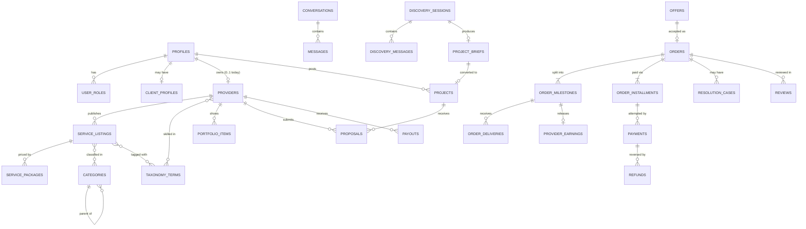

# Greco — Database Schema (proposal)

**Status:** Phase 1 proposal. Awaiting approval. Nothing is migrated yet.
**Last updated:** 2026-11-01
**Target:** Supabase Postgres 17, project `Greco` (eu-west-1) for development/staging.

This document is the logical design. Phase 2 turns it into SQL migrations under `supabase/migrations/`. Any later schema change must update this file in the same PR.

---

## 0. Mapping from the spec table list

| Spec suggestion | Proposal | Why |
|---|---|---|
| `users`, `user_profiles` | `auth.users` (Supabase) + `profiles` | Supabase owns credentials. `profiles` holds app data. |
| `user_roles` | `user_roles` (client/expert) + `staff_roles` | Marketplace roles and staff powers are kept apart. |
| `expert_profiles`, `agency_profiles` | `providers` (individual or agency) + `provider_agency_details` | One provider entity for both. Agency-only fields in a side table. |
| `skills`, `technologies` | `taxonomy_terms` with a `kind` (skill, technology, tool, framework, model, platform, industry, use_case) | One mechanism for synonyms, moderation and translation. |
| `portfolios` | dropped | One implicit portfolio per provider. Items reference `provider_id`. |
| `order_items` | `offer_line_items` of the accepted offer | Accepted offers are immutable, so a copy would only duplicate data. |
| `milestones` | `order_milestones` (needed now) | The deposit model ties the balance to a milestone. Simple orders have exactly one milestone. |
| `payment_records` | `payments` + `order_installments` | One payment per installment attempt. |
| `disputes` | `resolution_cases` (escalated status) | Cancellations, refund requests and disputes share one flow. |
| `AI_discovery_*`, `AI_project_briefs` | `discovery_sessions`, `discovery_messages`, `project_briefs`, `project_brief_versions`, `discovery_recommendations*` | Briefs are versioned so users can correct them. |
| `saved_experts` | `saved_providers` | Naming consistency. |
| — (new) | `offers*`, `order_installments`, `order_amendments`, `provider_earnings`, `ledger_*`, `file_objects`, `content_reports`, `moderation_actions`, `search_documents`, `outbox_events` | Needed for the payment addendum, trust and safety, search and reliability. |

---

## 1. Conventions

- **Schemas:** `public` (exposed through the Data API, RLS on every table), `app_private` (internal: not exposed), `extensions`.
- **Keys:** `uuid` primary keys (`gen_random_uuid()`). Human-friendly numbers where people need them (`orders.order_number` like `GR-26-004213`).
- **Time:** `timestamptz` everywhere. `created_at` defaults to `now()`. `updated_at` is maintained by a `moddatetime` trigger.
- **Money:** `*_minor bigint` plus `currency char(3)`. Rates in basis points (`*_bps integer`, 1000 = 10%). Check constraints such as `amount_minor >= 0`.
- **Enums:** Postgres enums for stable lifecycle sets (statuses). Lookup tables for anything admins manage (categories, taxonomy, verification types, notification types, review dimensions).
- **Deletion:** domain rows are archived or soft-deleted, not hard-deleted. Financial rows are never deleted. Foreign keys to financial rows use `ON DELETE RESTRICT`.
- **Text:** `citext` for handles and emails, length checks on user text, Markdown stored raw and sanitized at render time.
- **Notation below:** `pk`, `fk → table`, `uq` (unique), `ix` (index), `?` (nullable). Only key columns are listed. Audit timestamps are implied.

---

## 2. Core relationships



---

## 3. Identity and accounts

```
profiles                         (Class A for own text fields; status columns protected)
  id                uuid pk fk → auth.users(id) on delete cascade
  full_name         text                      -- private; never in public views
  display_name      text?                     -- optional public name for clients
  avatar_file_id    uuid? fk → file_objects
  country_code      char(2) fk → countries
  locale            text default 'en'         -- BCP 47
  timezone          text default 'UTC'
  active_role       marketplace_role          -- 'client' | 'expert'
  account_status    account_status            -- active | suspended | deactivated | pending_deletion | deleted
  deleted_at        timestamptz?

user_roles                       (Class C: changed only by identity functions)
  user_id           uuid fk → profiles
  role              marketplace_role
  status            role_status               -- active | suspended
  enabled_at, suspended_at?, suspension_reason?
  pk (user_id, role)

staff_roles                      (Class C, audited)
  user_id           uuid fk → profiles
  role              staff_role                -- super_admin | admin | moderator | support | finance
  granted_by        uuid fk → profiles
  granted_at, revoked_at?
  pk (user_id, role)

countries                        (admin-managed allow-list)
  code              char(2) pk
  can_register      bool
  can_buy           bool
  can_sell          bool                      -- depends on PSP payout support (A-02, X-10)
  default_currency  char(3)

legal_documents
  id uuid pk, kind legal_doc_kind (terms | privacy | provider_agreement | refund_policy | cookie_policy | acceptable_use)
  version text, locale text, content_sha256 text, url text, published_at
  uq (kind, version, locale)

legal_acceptances                (append-only)
  id uuid pk, user_id fk → profiles, document_id fk → legal_documents
  context text                              -- 'registration' | 'checkout' | 'provider_onboarding'
  accepted_at, ip_hash text?, user_agent text?

account_deletion_requests / data_export_requests
  id, user_id, status, requested_at, completed_at?, artifact_file_id? (exports), expires_at?
```

---

## 4. Client and provider profiles

```
client_profiles                  (Class A)
  user_id           uuid pk fk → profiles
  account_type      client_account_type       -- individual | business
  business_name     text?
  industry_term_id  uuid? fk → taxonomy_terms (kind = industry)
  company_size      company_size?             -- 1 | 2-10 | 11-50 | 51-200 | 201-1000 | 1000+
  website_url       text?
  purpose           text?                     -- why they use Greco (short)
  challenges        text?                     -- optional, private

providers                        (Class A text fields; status/stats protected)
  id                uuid pk
  owner_user_id     uuid fk → profiles  uq   -- unique today; relaxed when team seats arrive
  provider_type     provider_type             -- individual | agency
  handle            citext uq                 -- public URL slug
  display_name      text
  headline          text                      -- <= 120 chars
  bio               text                      -- Markdown, sanitized on render
  avatar_file_id, cover_file_id  uuid?
  country_code      char(2) fk → countries
  city              text?
  timezone          text
  experience_level  experience_level          -- emerging | established | expert
  years_experience  smallint?
  indicative_hourly_rate_minor bigint?, rate_currency char(3)?
  availability      availability_status       -- available | limited | unavailable
  availability_note text?
  website_url       text?
  status            provider_status           -- draft | pending_review | active | suspended | deactivated
  profile_completeness smallint               -- computed
  source_locale     text default 'en'
  published_at      timestamptz?
  ix (status), ix (country_code)

provider_agency_details          (1:1, agencies only)
  provider_id pk fk → providers, founded_year smallint?, team_size_range team_size?,
  office_locations text[]?, legal_name text? (private), registration_number text? (private)

provider_languages
  provider_id fk, language_code text, proficiency language_proficiency  -- basic | conversational | fluent | native
  pk (provider_id, language_code)

provider_terms                   (skills, technologies, tools, industries)
  provider_id fk, term_id fk → taxonomy_terms, years smallint?, is_featured bool
  pk (provider_id, term_id)

provider_links
  id, provider_id fk, kind link_kind (github | linkedin | huggingface | kaggle | website | x | youtube | scholar | other),
  url text, verified_at timestamptz?            -- set only by a verification process

provider_stats                   (read model, Class C, refreshed by job)
  provider_id pk, completed_orders int, active_orders int, rating_avg numeric(3,2), rating_count int,
  rating_bayes numeric(4,3), on_time_rate numeric, completion_rate numeric, response_rate numeric,
  median_response_minutes int, repeat_client_rate numeric, last_active_at timestamptz
```

---

## 5. Categories and taxonomy

```
categories
  id                uuid pk
  parent_id         uuid? fk → categories
  slug              citext                    -- uq (parent_id, slug)
  path              ltree uq                  -- maintained by trigger from slugs; subtree queries
  depth             smallint generated
  icon_key          text?                     -- maps to an icon set, not uploaded SVG
  image_file_id     uuid?
  sort_order        int
  is_active         bool                      -- inactive: hidden from new listings
  is_visible        bool                      -- shown in navigation
  ix gist (path)

category_translations
  category_id fk, locale text, name text, short_description text?, description text?,
  seo_title text?, seo_description text?
  pk (category_id, locale)                   -- 'en' row required (constraint trigger)

category_relations
  category_id fk, related_category_id fk, relation_kind (related | see_also), sort_order
  pk (category_id, related_category_id)

taxonomy_terms
  id uuid pk, kind term_kind, slug citext, status term_status (active | pending | merged | retired),
  merged_into_id uuid? fk → taxonomy_terms, suggested_by uuid? fk → profiles
  uq (kind, slug)

taxonomy_term_translations    (term_id, locale, name, description?)  pk (term_id, locale)
taxonomy_term_aliases         (term_id, alias citext, locale)        uq (alias, locale)   -- synonyms
category_terms                (category_id, term_id, weight smallint) -- suggested skills/use cases per category
```

- Deactivating a category never deletes it. Listings in it keep their link until reassigned (admin tool), and search hides inactive categories.
- Renaming a slug rewrites the `path` of the subtree in one transaction. Moving a category does the same.
- Experts can suggest new terms (`pending`). Moderators approve, merge or reject them.
- `use_case` and `industry` terms connect business problems to categories, which is how both AI Discovery and search handle problem-style queries.

---

## 6. Catalog: service listings

```
service_listings
  id                uuid pk
  provider_id       uuid fk → providers
  slug              citext                    -- uq (provider_id, slug)
  status            listing_status            -- draft | pending_review | published | paused | archived | rejected | suspended
  title             text
  summary           text                      -- card text, <= 200 chars
  description       text                      -- Markdown
  primary_category_id uuid fk → categories
  pricing_model     pricing_model             -- fixed | packages | hourly | quote
  currency          char(3)
  fixed_price_minor bigint?                   -- pricing_model = fixed
  hourly_rate_minor bigint?, min_hours smallint?   -- pricing_model = hourly (prepaid blocks, A-10)
  quote_from_minor  bigint?                   -- optional "starting at" for quote
  base_delivery_days smallint?
  payment_model     payment_model             -- full | deposit
  deposit_bps       integer?                  -- e.g. 3000 = 30%; check against allowed set
  balance_trigger   balance_trigger?          -- on_milestone_acceptance | before_final_delivery
  revisions_included smallint?
  revision_policy   text?
  requirements_intro text?
  source_locale     text
  version           int                       -- bumped on each published edit
  published_at, paused_at, archived_at  timestamptz?
  moderation_note   text?                     -- staff only (column privilege)
  check (payment_model = 'full' or (deposit_bps is not null and balance_trigger is not null))

service_listing_categories    (listing_id, category_id, is_primary)   -- primary + up to 2 secondary
service_listing_terms         (listing_id, term_id)

service_packages
  id, listing_id fk, tier smallint (1..3), name text, description text,
  price_minor bigint, delivery_days smallint, revisions_included smallint, is_active bool

service_deliverables
  id, listing_id fk, package_id uuid? fk,     -- null = applies to every package
  title text, description text?, sort_order

service_addons
  id, listing_id fk, title, description?, price_minor bigint, extra_delivery_days smallint, is_active

service_requirements             (questions the client answers after paying)
  id, listing_id fk, prompt text, input_type requirement_input (text | long_text | file | url | choice | multi_choice),
  options jsonb?, is_required bool, sort_order

service_faqs                  (id, listing_id, question, answer, sort_order)
service_media                 (id, listing_id, file_id? | external_video_url?, kind (image | video | pdf), alt_text, sort_order)
```

Publishing runs through `listings_submit_for_review` and `listings_publish` functions. A listing can only be published if the provider is `active`, the payment terms are valid and (per A-17) the payout account is ready before the first order can be placed.

---

## 7. Portfolio and evidence

```
portfolio_items
  id uuid pk, provider_id fk
  title, summary, problem text?, solution text?, results text?, role text?
  client_display_name text?                 -- only with permission
  industry_term_id uuid?
  project_date date?
  external_url text?
  provenance        portfolio_provenance      -- self_reported | greco_order | greco_verified
  order_id          uuid? fk → orders         -- required when provenance = greco_order
  client_consented_at timestamptz?            -- required for greco_order items
  verification_id   uuid? fk → verifications  -- required when provenance = greco_verified
  is_case_study bool, visibility (public | hidden), status (draft | published | hidden_by_moderation), sort_order

portfolio_item_terms          (item_id, term_id)
portfolio_item_media          (id, item_id, file_id? | external_video_url?, kind, caption, sort_order)
```

`provenance` can only be raised by system functions: `greco_order` once a linked order is completed and the client has consented, `greco_verified` once a staff verification is approved. Providers can only create `self_reported` items.

---

## 8. Verification and trust

```
verification_types               (admin-managed)
  key text pk                                -- email | identity | business | portfolio_item | credential | payout_kyc | ...
  subject_kind (user | provider | portfolio_item)
  is_public_badge bool, validity_days int?, method_default (vendor | manual | automatic), is_active bool
  label_key, description_key                 -- i18n keys; description says exactly what is checked

verification_requests
  id, type_key fk, subject_type, subject_id, requested_by fk → profiles
  status verification_request_status  -- draft | submitted | in_review | approved | rejected | expired | cancelled
  method, vendor text?, vendor_reference text?, evidence_file_ids uuid[]?
  reviewer_id uuid?, decision_reason text?, submitted_at?, decided_at?

verifications                    (granted state; Class C)
  id, type_key fk, subject_type, subject_id, request_id fk?, granted_at, expires_at?, revoked_at?, revoked_reason?
  ix (subject_type, subject_id) where revoked_at is null
```

- Badges come only from active `verifications` rows, exposed through a `public_badges` view (subject, type, granted date).
- Email verification is copied from `auth.users.email_confirmed_at` by trigger.
- The PSP's KYC status lives on `payout_accounts` and is **not** a public identity badge unless A-22 approves it.
- The UI explains each badge ("Identity verified: a government ID was checked by <vendor> on <date>. This does not confirm technical skills.").

---

## 9. Projects and proposals

```
projects
  id uuid pk, client_user_id fk → profiles
  title, description, business_problem text?, desired_outcome text?
  category_id uuid? fk
  budget_kind (fixed | range | hourly | not_sure), budget_min_minor?, budget_max_minor?, currency char(3)?
  timeline_kind (asap | weeks | months | flexible), deadline date?
  visibility (public | invite_only), status project_status  -- draft | open | in_review | hired | closed | cancelled | expired | removed
  source (manual | discovery), brief_id uuid? fk → project_briefs
  proposals_count int, published_at?, expires_at?, closed_at?

project_terms                 (project_id, term_id)
project_attachments           (project_id, file_id)
project_invitations           (id, project_id, provider_id, invited_by, message?, status (sent | viewed | declined | proposal_submitted), created_at)

proposals
  id uuid pk, project_id fk, provider_id fk, submitted_by_user_id fk
  status proposal_status       -- draft | submitted | shortlisted | declined | withdrawn | accepted | expired
  proposed_solution text, relevant_experience text?, questions text?, conditions text?
  currency, price_minor bigint, pricing_model (fixed | hourly_block), hours smallint?
  estimated_days smallint, revisions_included smallint?
  payment_model, deposit_bps?, balance_trigger?
  valid_until timestamptz?, submitted_at?, decided_at?
  uq (project_id, provider_id) where status not in ('withdrawn','declined','expired')

proposal_deliverables         (id, proposal_id, title, description?, sort_order)
proposal_milestones           (id, proposal_id, seq, title, description?, amount_minor, due_offset_days)
```

---

## 10. Offers (immutable purchase terms)

Every purchase becomes an offer. Package checkout creates one automatically. Custom offers are sent in chat. Accepting a proposal creates one from the proposal. Once an offer is `accepted`, a trigger blocks every update.

```
offers
  id uuid pk
  kind offer_kind              -- package_checkout | custom_offer | proposal
  provider_id fk, client_user_id fk
  listing_id?, listing_version int?, package_id?, project_id?, proposal_id?, conversation_id?
  status offer_status          -- draft | sent | accepted | declined | withdrawn | expired | superseded
  title, scope_description text
  currency char(3)
  subtotal_minor, client_fee_minor, total_minor bigint
  delivery_days smallint, revisions_included smallint?
  payment_model, deposit_bps?, balance_trigger?
  fee_policy_snapshot jsonb    -- resolved commission policy at creation (provider_bps, client_bps, fixed fees, policy id)
  cancellation_policy_version text, refund_policy_version text
  requirements_snapshot jsonb  -- listing requirements at time of offer
  terms_sha256 text            -- hash of canonical JSON of all terms; stored with the client's acceptance
  expires_at?, accepted_at?

offer_line_items              (id, offer_id, kind (package | addon | hours | custom | milestone), ref_id?, description, quantity, unit_price_minor, amount_minor)
offer_deliverables            (id, offer_id, title, description?, sort_order)
offer_milestones              (id, offer_id, seq, title, description?, amount_minor, due_offset_days)
offer_installments            (id, offer_id, seq, kind (full | deposit | balance | milestone), amount_minor,
                               due_trigger (at_checkout | on_milestone_acceptance | before_final_delivery), milestone_seq?)
```

---

## 11. Orders and fulfilment

```
orders                           (Class B)
  id uuid pk, order_number text uq
  offer_id uuid uq fk → offers
  client_user_id fk, provider_id fk, listing_id?, project_id?, conversation_id fk
  status order_status          -- pending_payment | awaiting_requirements | in_progress | awaiting_balance
                               -- | delivered | revision_requested | completed | cancelled | expired
  currency char(3), total_minor, commission_expected_minor, provider_net_expected_minor
  open_case_id uuid?           -- set while a resolution case is open; freezes timers
  requirements_submitted_at?, started_at?, due_at?, delivered_at?, auto_complete_at?,
  completed_at?, cancelled_at?
  completion_reason (client_accepted | auto_completed | case_resolution | admin)?
  cancellation_reason text?
  ix (client_user_id, status), ix (provider_id, status), ix (status, auto_complete_at), ix (status, due_at)

order_milestones
  id, order_id fk, seq smallint, title, description?, amount_minor
  status milestone_status      -- pending | in_progress | delivered | revision_requested | accepted | cancelled
  due_at?, accepted_at?
  uq (order_id, seq)

order_installments
  id, order_id fk, seq smallint, kind (full | deposit | balance | milestone | amendment)
  subtotal_minor               -- this installment's share of the agreed price
  client_fee_minor             -- client service fee on this installment (0 if A-03 keeps client fee at 0%)
  amount_minor                 -- what the client pays = subtotal_minor + client_fee_minor
  commission_minor             -- Greco commission deducted from the provider's side
  provider_net_minor           -- = subtotal_minor - commission_minor (before processing fees, see PAYMENT_ARCHITECTURE §8)
  currency
  due_trigger, milestone_id uuid?
  status installment_status    -- scheduled | due | processing | paid | failed | cancelled | refunded | partially_refunded
  due_at?, paid_at?
  check (amount_minor = subtotal_minor + client_fee_minor)
  check (provider_net_minor + commission_minor = subtotal_minor)

order_requirement_responses   (id, order_id, requirement_snapshot jsonb, answer_text?, file_ids uuid[]?, submitted_at)

order_deliveries
  id, order_id fk, milestone_id fk, submitted_by fk, message text, is_final bool
  status delivery_status       -- submitted | accepted | revision_requested | superseded
  submitted_at, respond_by_at, responded_at?

order_delivery_items          (id, delivery_id, kind (file | link | repository | text | credential_note), file_id?, url?, label, body?)

order_revisions               (id, order_id, delivery_id, requested_by, details text, counts_against_limit bool, created_at)

order_amendments
  id, order_id fk, proposed_by fk
  kind (deadline_extension | scope_change | price_change | add_extra | payment_terms_change | milestone_change)
  proposed_changes jsonb, price_delta_minor bigint default 0
  status (proposed | accepted | declined | withdrawn | expired), respond_by_at, responded_at?
  -- an accepted price increase creates a new 'amendment' installment that must be paid

order_events                     (append-only timeline; both parties see a filtered view)
  id, order_id fk, actor_user_id?, actor_kind (client | provider | staff | system | psp)
  event_type text, from_status?, to_status?, payload jsonb, created_at
  ix (order_id, created_at)
```

Payment terms (`payment_model`, deposit, installments, prices) can only change through an accepted `order_amendments` row. The transition function rejects any other path (D-13).

---

## 12. Payments, earnings, payouts and ledger

```
customer_accounts             (user_id pk, psp text, psp_customer_id text)            -- Class C
payout_accounts                                                                     -- Class C
  id, provider_id fk uq, psp text, psp_account_id text, country_code, default_currency
  status (not_started | onboarding | pending_verification | active | restricted | disabled)
  charges_enabled bool, payouts_enabled bool, requirements_due jsonb (sanitized), updated_from_psp_at

payments                                                                            -- Class C
  id, order_id fk, installment_id fk, payer_user_id fk, psp text
  psp_payment_ref text uq, psp_charge_ref text?
  amount_minor, currency, processing_fee_minor bigint?   -- actual fee, known after settlement
  status payment_status    -- requires_action | processing | succeeded | failed | cancelled | refunded | partially_refunded | disputed
  idempotency_key text uq, failure_code?, failure_message?, succeeded_at?

refunds                                                                             -- Class C
  id, payment_id fk, order_id fk, resolution_case_id uuid?
  amount_minor, currency, reason refund_reason, initiated_by_kind (client | provider | staff | system), initiated_by uuid?
  psp_refund_ref text uq?, status (pending | processing | succeeded | failed | cancelled)
  commission_reversed_minor, provider_reversed_minor, platform_absorbed_minor
  recoverable_from_provider bool, provider_recovery_minor bigint default 0
  blocked_by_psp_rule bool default false, failure_reason text?, processed_at?

payment_disputes   (chargebacks)                                                    -- Class C
  id, payment_id fk, psp_dispute_ref uq, reason text, amount_minor, currency
  status (warning | needs_response | under_review | won | lost | closed)
  evidence_due_by?, evidence_submitted_at?, liability (platform | provider | shared | undetermined)

provider_earnings                (one row per milestone; created when its funding installments are paid)  -- Class C
  id, provider_id fk, order_id fk, milestone_id fk uq
  gross_minor, commission_minor, fees_charged_to_provider_minor, net_minor, currency
  -- commission is taken per installment (when the PSP charges) and allocated to milestones proportionally;
  -- rounding remainder goes to the last milestone (PAYMENT_ARCHITECTURE §8.2)
  status earning_status    -- pending | clearing | available | paid_out | on_hold | reversed | partially_reversed
  clearing_until timestamptz?, hold_reason text?, payout_id uuid?

payouts                                                                             -- Class C
  id, provider_id fk, payout_account_id fk, psp text
  psp_transfer_ref text?, psp_payout_ref text?, amount_minor, currency
  status (pending | in_transit | paid | failed | cancelled | reversed)
  initiated_at?, paid_at?, failure_reason?

commission_policies              (admin-managed, versioned, audited)
  id, name, scope (global | category | provider | country), scope_id uuid?
  provider_commission_bps int, client_fee_bps int, client_fee_fixed_minor bigint, min_commission_minor bigint?, currency char(3)?
  effective_from timestamptz, effective_to timestamptz?, created_by, approved_by
  -- most specific active policy wins; the result is snapshotted into offers (never recomputed later)

platform_settings              (key text pk, value jsonb, schema jsonb, description, updated_by, updated_at)
platform_settings_history      (append-only copy of every change)
feature_flags                  (key pk, enabled bool, rules jsonb)

invoices                         (only after X-04 confirms what is legally required)
  id, order_id, installment_id?, kind (client_receipt | commission_invoice | self_billing_invoice | credit_note)
  series text, number int, uq (series, number)   -- gapless numbering per series
  issuer, recipient jsonb, subtotal_minor, tax_minor, tax_rate_bps, total_minor, currency, file_id, issued_at

app_private.tax_profiles         (DAC7/OECD reporting data, encrypted at application level)
  subject_kind, subject_id, tax_residence_country, tin_encrypted, vat_id, vat_validated_at,
  date_of_birth_encrypted?, address_encrypted, reportable bool

app_private.ledger_accounts
  id, kind (psp_funds | provider_payable | provider_receivable | commission_deferred | commission_revenue
            | client_fee_revenue | processing_fees | refunds_clearing | chargeback_losses | platform_losses | client_credit)
  owner_kind (platform | provider | client), owner_id uuid?, currency
  uq (kind, owner_kind, owner_id, currency)

app_private.ledger_transactions
  id, occurred_at, kind (payment_captured | commission_recognized | refund | chargeback | chargeback_reversal
                         | earnings_released | payout_paid | processing_fee | adjustment | recovery_offset)
  order_id?, payment_id?, refund_id?, payout_id?, dispute_id?, description, idempotency_key uq, created_by

app_private.ledger_entries
  id, transaction_id fk, account_id fk, amount_minor bigint (+ debit / − credit), currency
  -- constraint trigger: for each (transaction_id, currency) sum(amount_minor) = 0
  -- no UPDATE/DELETE (trigger + revoked privileges)

app_private.psp_webhook_events  (id, psp, event_id uq, type, payload jsonb, received_at, processed_at?, status, attempts, last_error?)
app_private.reconciliation_runs / reconciliation_items  (PSP balance transactions vs ledger; mismatches for finance review)
```

---

## 13. Resolution center (cancellations, refunds, disputes)

```
resolution_cases                 (Class B; admin decisions Class C)
  id uuid pk, order_id fk, opened_by fk, opened_by_kind (client | provider | staff)
  type case_type           -- cancel_before_start | cancel_non_delivery | late_delivery | scope_mismatch
                           -- | incomplete_delivery | client_unresponsive | client_non_payment
                           -- | partial_refund | full_refund | deadline_extension | post_completion_review | other
  requested_outcome (cancel_full_refund | partial_refund | extend_deadline | revision | release_payment | other)
  requested_amount_minor bigint?
  reason text
  status case_status       -- awaiting_response | countered | accepted | declined | escalated | under_review
                           -- | resolved | withdrawn | expired
  respond_by_at timestamptz, escalated_at?, assigned_staff_id?
  resolution (full_refund | partial_refund | release_to_provider | split | redo | extension | no_action)?
  resolution_amount_minor?, resolution_note?, statement_of_reasons text?, resolved_by?, resolved_at?
  uq (order_id) where status in ('awaiting_response','countered','escalated','under_review')   -- one open case per order

resolution_case_events
  id, case_id fk, actor_user_id?, actor_kind, kind (opened | responded | countered | evidence_added | escalated | staff_note | decision)
  body text?, amount_minor?, file_ids uuid[]?, visibility (parties | staff_only), created_at
```

The full rules and timers are in [PAYMENT_ARCHITECTURE.md §9](PAYMENT_ARCHITECTURE.md#9-cancellations-refunds-disputes-and-recovery).

---

## 14. Reviews

```
reviews
  id, order_id fk, direction (client_to_provider | provider_to_client)
  reviewer_user_id fk, provider_id fk
  overall_rating smallint check (1..5), body text?
  status (submitted | published | hidden | removed)
  visible_at timestamptz?          -- double-blind reveal time
  uq (order_id, direction)

review_dimensions              (key pk, label_key, is_active, category_id? -- optional category-specific dimensions)
review_ratings                 (review_id, dimension_key, rating smallint)  pk (review_id, dimension_key)
review_responses               (review_id pk, provider_id, body, status, created_at)
```

`reviews_submit` checks: the reviewer is the order's client (or provider owner for the other direction), the order is `completed`, the review window is open, no review exists yet for that direction, and reviewer and provider owner are different users.

---

## 15. Messaging

```
conversations
  id, kind (direct | order | support), client_user_id?, provider_id?, order_id? uq, created_by
  context_listing_id?, context_project_id?            -- latest context, for display
  status (active | archived | locked), last_message_at
  uq (client_user_id, provider_id) where kind = 'direct'

conversation_participants
  conversation_id fk, user_id fk, participant_kind (client | provider | staff)
  provider_id uuid?, joined_at, last_read_message_id?, last_read_at?, muted bool, archived_at?, left_at?
  pk (conversation_id, user_id)

messages                         (Class B: inserted via messages_send)
  id, conversation_id fk, sender_user_id fk?, kind (text | system | offer | attachment)
  body text?, offer_id uuid?, context_listing_id?, context_project_id?
  moderation_state (visible | masked | held | removed), contact_flags text[]
  edited_at?, deleted_at?, created_at
  ix (conversation_id, created_at desc)

message_attachments           (message_id, file_id) pk
user_blocks                   (blocker_user_id, blocked_user_id, created_at) pk
app_private.contact_policy_events (id, message_id, user_id, signals text[], action (warned | masked | held | flagged), created_at)
```

---

## 16. Trust and safety

```
content_reports
  id, reporter_user_id fk?, target_type (message | user | provider | listing | review | project | portfolio_item | proposal)
  target_id uuid, reason report_reason, details text?
  status (open | triaged | actioned | dismissed), handled_by?, handled_at?

moderation_actions               (Class C, audited)
  id, target_type, target_id, action (approve | reject | hide | remove | restore | warn | suspend_role | suspend_account | reinstate)
  reason_code, statement_of_reasons text      -- sent to the affected user (DSA / P2B)
  actor_staff_id, report_id?, appeal_status (none | requested | upheld | reversed), created_at
```

---

## 17. Notifications and saved items

```
notification_types             (key pk, category, default_channels text[], user_configurable bool, title_key, body_key)
notifications
  id, user_id fk, type_key fk, actor_user_id?, entity_type, entity_id, params jsonb, read_at?, created_at
  ix (user_id, created_at desc), partial ix (user_id) where read_at is null
notification_preferences       (user_id, type_key, channel (in_app | email | push), enabled)  pk (user_id, type_key, channel)
app_private.notification_deliveries (id, notification_id, channel, status, provider_ref?, attempts, sent_at?, error?)

saved_providers                (user_id, provider_id, created_at) pk
saved_services                 (user_id, listing_id, created_at) pk
saved_categories               (user_id, category_id, created_at) pk
saved_searches                 (id, user_id, name, query jsonb, alerts_enabled bool, last_alerted_at?)
```

Separate tables (instead of one polymorphic "saved items" table) keep real foreign keys.

---

## 18. AI Discovery

```
discovery_sessions
  id, user_id uuid?, guest_token_hash text?        -- exactly one of the two
  status (active | brief_ready | completed | abandoned | archived)
  title text?, locale, current_brief_id uuid?
  message_count int, input_tokens bigint, output_tokens bigint, est_cost_micros bigint
  flagged bool, last_activity_at, expires_at?      -- guest sessions expire
  claimed_at?                                      -- guest session attached to a new account

discovery_messages
  id, session_id fk, role (user | assistant | system_event)
  content text                                     -- what the user saw
  structured jsonb?                                -- validated assistant output (questions, quick replies, suggested actions)
  prompt_version text?, model text?, input_tokens?, output_tokens?, cache_read_tokens?, latency_ms?
  safety_flags text[]?, created_at

project_briefs
  id, owner_user_id uuid?, session_id uuid?, status (draft | confirmed | converted | archived)
  current_version int, title text, converted_project_id uuid?

project_brief_versions
  brief_id fk, version int, content jsonb          -- validated against the brief schema (docs/AI_DISCOVERY.md §6)
  author (assistant | user), created_at
  pk (brief_id, version)

discovery_recommendations
  id, session_id fk, brief_id fk, brief_version int, algorithm_version text, retrieval_params jsonb, created_at

discovery_recommendation_items
  recommendation_id fk, rank smallint, entity_type (provider | listing), entity_id uuid
  score numeric, score_breakdown jsonb             -- text, taxonomy, rating, price_fit, availability, ...
  reasons jsonb                                    -- [{text, evidence: [{field, provenance}]}]
  clicked_at?, contacted_at?, ordered_at?
  pk (recommendation_id, rank)

app_private.llm_usage_events
  id, feature, user_id?, session_id?, provider, model, input_tokens, output_tokens,
  cache_read_tokens, cache_write_tokens, est_cost_micros, latency_ms, status, error_code?, created_at

app_private.usage_counters     (subject_key text, window_start timestamptz, requests int, tokens bigint)  pk (subject_key, window_start)
```

---

## 19. Search, files, analytics, audit, outbox

```
search_documents                 (Class C, refreshed by job)
  entity_type (listing | provider), entity_id uuid, pk (entity_type, entity_id)
  provider_id, title, summary, document tsvector
  category_ids uuid[], category_paths ltree[], term_ids uuid[]
  provider_type, country_code, language_codes text[]
  price_from_minor?, currency?, price_from_usd_minor?, delivery_days_min?, pricing_models text[]
  rating_bayes numeric, rating_count int, completed_orders int
  badges text[], availability, quality_score numeric, is_visible bool, published_at, refreshed_at
  -- later: embedding vector(n) + HNSW index
  ix gin (document), gin (category_ids), gin (term_ids), gist (category_paths), gin (title gin_trgm_ops)

file_objects
  id, bucket, path uq, owner_user_id, purpose (avatar | listing_media | portfolio_media | message_attachment
                                               | project_attachment | delivery | verification_evidence | export)
  mime_type, size_bytes bigint, sha256, scan_status (pending | clean | infected | error | skipped), created_at, deleted_at?

app_private.analytics_events   (id, name, user_id?, anonymous_id?, properties jsonb, occurred_at)   -- partition monthly later
app_private.search_queries     (id, session_key, query_text (truncated), filters jsonb, result_count, clicked_entity?, created_at)  -- 90-day retention

app_private.audit_logs           (append-only; no UPDATE/DELETE)
  id, occurred_at, actor_user_id?, actor_kind (user | staff | system | psp)
  action text                    -- e.g. 'order.refund.issued', 'settings.commission.updated', 'conversation.viewed_by_staff'
  target_type, target_id, before jsonb?, after jsonb?, reason text?, request_id, ip_hash?

app_private.outbox_events        (id, topic, aggregate_type, aggregate_id, payload jsonb, created_at, processed_at?, attempts, last_error?)
```

---

## 20. Row Level Security strategy

| Data | Read | Write |
|---|---|---|
| Public catalog (published listings, active providers, categories, taxonomy, public badges, published reviews) | Everyone, through public views that expose only public columns | Class A/B rules |
| Own account data (profile, client profile, saved items, notifications, preferences) | Owner | Owner (Class A) |
| Provider private data (draft listings, earnings, payout account) | Provider owner | Class A drafts; Class C money |
| Orders, offers, deliveries, milestones, installments, resolution cases | The two parties (client, provider owner); staff with the right role | Class B functions only |
| Conversations and messages | Participants; staff only through a case or report (audited) | Class B function |
| Discovery sessions, briefs | Owner (or guest token holder through the server) | Server |
| Financial tables, verifications, settings, audit | Relevant party through views (for example own payments); finance and admin staff | Class C only |

- Helper functions (`is_order_party(order_id)`, `owns_provider(provider_id)`, `has_staff_role(role)`) are `SECURITY DEFINER`, `STABLE` and use `(select auth.uid())` for performance.
- Staff policies also require `auth.jwt() ->> 'aal' = 'aal2'` (MFA).
- CI fails if any table in `public` lacks RLS or has a policy granting `anon` write access.

## 21. Indexing notes

- Every foreign key used in a policy or join is indexed.
- Partial indexes for timers, for example `orders (auto_complete_at) where status = 'delivered' and open_case_id is null`.
- GIN for `tsvector`, arrays and trigram. GiST for `ltree`.
- `(conversation_id, created_at desc)` and `(user_id, created_at desc)` for feeds. Keyset pagination everywhere.

## 22. Data retention (proposal, legal to confirm under X-08 and X-14)

| Data | Retention |
|---|---|
| Financial records, invoices, ledger, order terms | Statutory period (often 6–10 years), pseudonymised after account deletion |
| Messages | Life of the account. Kept for the counterparty after one side deletes (shown as "Deleted user"), unless law requires otherwise |
| Guest discovery sessions | 30 days |
| User discovery sessions | Until the user deletes them or the account |
| Search query logs | 90 days, then aggregated |
| Verification evidence (manual) | Deleted 30 days after decision; the decision record is kept |
| Audit logs | 7 years (proposal) |
| Webhook payloads | 90 days (event IDs kept longer for idempotency) |

## 23. How the schema covers the required capabilities

| Requirement (spec §21) | Where |
|---|---|
| Role switching | `profiles.active_role`, `user_roles`, separate per-role profiles |
| Multiple services per provider | `service_listings.provider_id` |
| Individual and agency providers | `providers.provider_type`, `provider_agency_details` |
| Dynamic categories | `categories` (adjacency + `ltree`), translations, relations |
| Custom projects and proposals | `projects`, `proposals`, `project_invitations` |
| Direct service purchases | `offers (package_checkout)` → `orders` |
| Full upfront and deposit payments | `offer_installments`, `order_installments`, `order_milestones` |
| Refunds and disputes | `refunds`, `payment_disputes`, `resolution_cases` |
| Verified reviews | `reviews` + eligibility checks in `reviews_submit` |
| AI Discovery | `discovery_*`, `project_briefs*`, `discovery_recommendations*` |
| Future internationalization | `locale` fields, `*_translations`, `source_locale`, notification keys |
| Future agency team seats | `provider_id` everywhere; `providers.owner_user_id` uniqueness can be relaxed |
