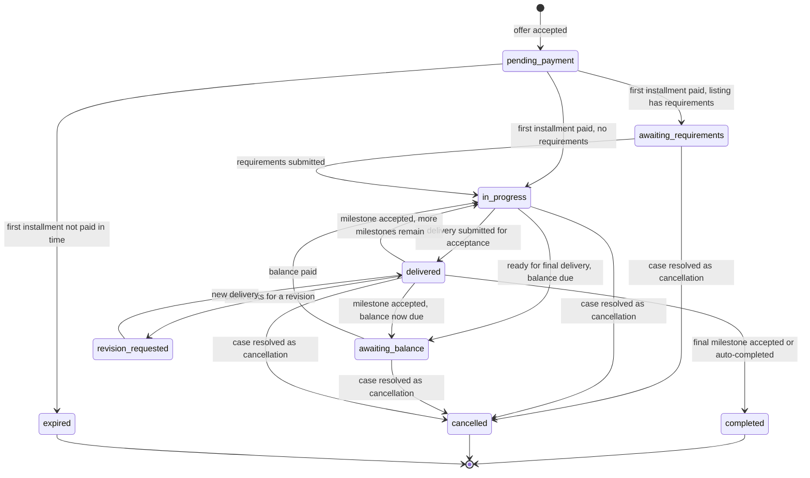
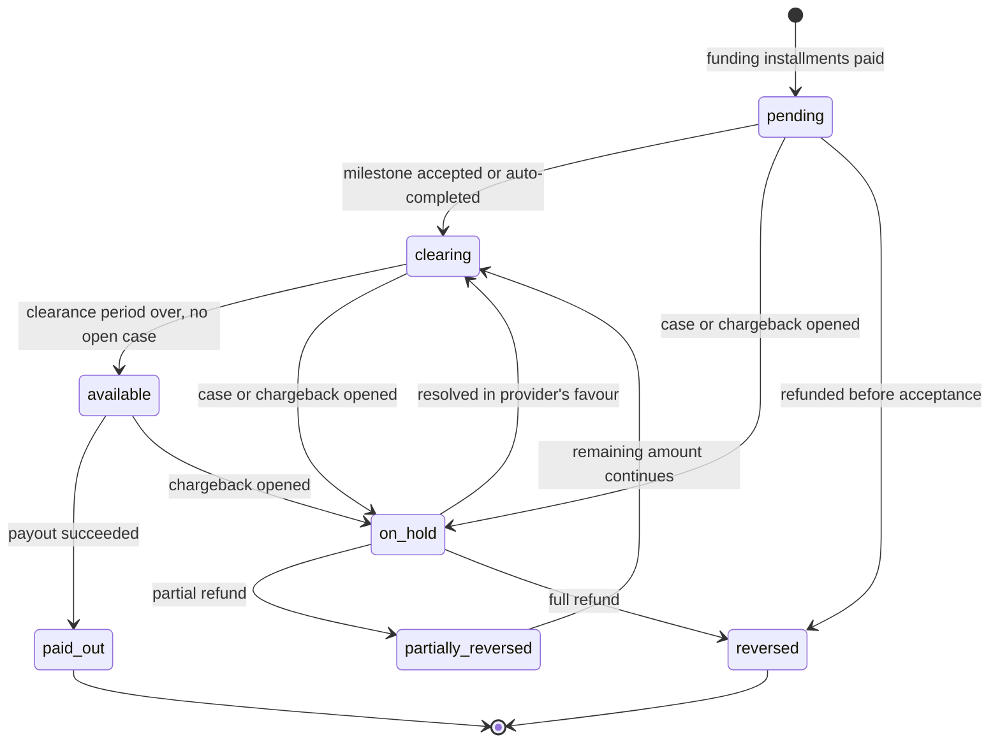
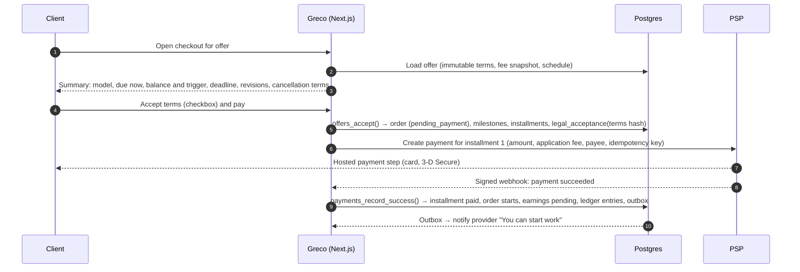

# Greco — Payment and Payout Architecture

**Status:** Approved by the product owner on 2026-11-01. **Real payments are BLOCKED** until the decisions below are confirmed in writing.
**Last updated:** 2026-11-01

Related: [PRODUCT_DECISIONS.md](PRODUCT_DECISIONS.md) (A-01 to A-18, X-01 to X-14) · [DATABASE_SCHEMA.md §10–13](DATABASE_SCHEMA.md) · [SECURITY.md](SECURITY.md)

---

## 1. Status and blocking decisions

| Blocker | What is needed | Owner |
|---|---|---|
| A-02 | Greco's legal entity jurisdiction and launch countries | Product owner |
| X-01 | PSP selection and fund-flow model, confirmed in writing by the PSP for a professional-services marketplace with prepayment and conditional release | Product owner + PSP |
| X-02, X-03 | Merchant of record; licensing analysis of the fund flow | Legal counsel |
| X-04 | Tax, invoicing and platform-reporting obligations | Tax adviser |
| X-05 | Consumer-law requirements at checkout (EU withdrawal right) | Legal counsel |
| X-11, X-13 | Terms of Service, Provider Agreement (including deductions from future earnings), chargeback and negative-balance liability | Legal counsel + PSP |

**What can be built before these are resolved:** the whole order, payment-schedule, resolution and ledger system against a **sandbox adapter** (Phase 6). **What cannot happen:** charging real cards, onboarding real payees, or paying anyone out.

---

## 2. Principles

1. **Greco does not hold client funds itself.** A licensed PSP holds them under a structure it explicitly supports. Greco *instructs* releases and *records* obligations.
2. **No card data touches Greco.** Payment details are entered only in the PSP's hosted fields or checkout, which keeps Greco in the lowest PCI scope.
3. **No simulated success in production.** The sandbox adapter cannot load when `APP_ENV=production`. Payments carry a `livemode` flag, and the production database rejects non-live payments.
4. **The PSP is the source of truth for money movement.** An order only becomes paid when a verified PSP webhook (or a verified API read) confirms it, never because the browser says so.
5. **Agreed terms are immutable.** Price, payment model, schedule, deadline, revisions and policies are snapshotted in the accepted offer. Changes need an amendment accepted by the client.
6. **Collection, earnings and payout are separate,** each with its own status that the relevant user can see.
7. **Integer minor units only.** Explicit, tested rounding rules.
8. **Every money event is idempotent and appears in the ledger.**
9. **No invented guarantees.** The UI never promises refunds, instant payouts or "escrow protection". It describes what actually happens, with the limits.

---

## 3. The core problem: someone must hold the money between payment and payout

Clients pay before work starts, and providers are paid after the work is accepted. In between, **the money sits somewhere**. The spec rules out Greco holding it in its own bank account, which is right. But "no escrow" cannot mean "nobody holds it". It must mean **a licensed PSP holds it under a model built for marketplaces.**

What we confirmed from Stripe's public documentation on 2026-11-01 (to be reconfirmed directly with any PSP):

- Stripe states that it **does not provide escrow services or escrow accounts**. Delayed payouts are offered for cases like delayed delivery or possible refunds.
- With **manual payouts**, funds stay in the connected account's balance, but must be paid out within a holding period: **2 years in the US, 10 days in Thailand, 90 days in all other countries**.
- **Separate charges and transfers** (funds wait in the platform's balance) are recommended by Stripe only when the platform is responsible for negative balances. Cross-border transfers on that model only work between the **US, Canada, UK, EEA and Switzerland**.
- Connect **cross-border payouts** are US-platform only and can't go to accounts under the recipient service agreement. Paying people outside Connect's reach uses **Global Payouts**, a separate product whose senders must be in the US or UK.

**Consequences for Greco:**

1. **Long fully prepaid orders are limited by hold periods.** A 6-month project paid 100% upfront can't wait until the end to release funds if the PSP's hold limit is 90 days. → A-07: cap prepaid durations by PSP capability. Longer projects use Model B with milestone installments.
2. **Launch countries are limited by payout support.** → A-02 and the `countries.can_sell` flag.
3. **Platform liability doesn't vanish.** In most marketplace setups, if a provider's balance can't cover a refund or chargeback, the platform owes the PSP. → X-13, risk reserve, release only after acceptance plus clearance.

---

## 4. PSP options

| Option | Where funds wait | Fit | Main limits and risks |
|---|---|---|---|
| **1. Connected accounts + delayed payouts** (for example Stripe Connect with manual payout schedules) | In each provider's balance at the PSP | Good, within hold limits | Hold limits (above); providers must be in supported countries; liability for negative balances depends on account configuration |
| **2. Platform balance + separate transfers** (for example Stripe separate charges and transfers) | In Greco's balance at the PSP until transferred | Flexible timing | Greco is more clearly in the flow of funds → licensing review (X-03); cross-border limits |
| **3. Licensed e-money wallets** (for example Mangopay or other EU e-money institutions) | E-money wallets under the PSP's licence | Built for "hold until delivery" | EU-centric; verify hold durations, KYC thresholds, payout reach, pricing |
| **4. Enterprise platform** (for example Adyen for Platforms) | Balance accounts under the PSP's licence | Good | Commercial onboarding, volume minimums |
| **5. Collection and payouts with different providers** (card acquiring + Global Payouts, PayPal/Hyperwallet, Payoneer, Wise) | Greco's merchant balance in between | Widest payout reach | Greco holds third-party funds → strongest licensing concern. **Only with explicit legal sign-off.** |

**Recommendation (not a final selection):**
1. Decide A-02 (entity and launch countries) first.
2. If the entity is in the US, UK or EEA, evaluate **Option 1 (Stripe Connect)** as the primary candidate for developer tooling, hosted KYC, application fees and refunds. If the entity is in the EU and long holds matter, evaluate **Option 3 (Mangopay)** in parallel.
3. Send the questionnaire in §17 to each candidate and get written answers.
4. No Option 5 without legal sign-off.

---

## 5. Payment models, milestones and the payment schedule

Every order has **1..N milestones** (what gets delivered and accepted) and **1..N installments** (what gets paid, and when). The UI hides milestones when there is only one.

| | Model A: Full payment | Model B: Deposit |
|---|---|---|
| Installments | 1: 100% at checkout | Deposit (provider-chosen %, from the allowed set, A-05) at checkout + balance later |
| Balance trigger | — | `on_milestone_acceptance` (balance due when milestone 1 is accepted) or `before_final_delivery` (balance due when the provider marks the work ready for final delivery) |
| Milestones | 1 (or several for longer prepaid work, within A-07) | `before_final_delivery`: 1 milestone funded by both installments. `on_milestone_acceptance`: milestone 1 = deposit amount, milestone 2 = balance amount |
| Who pays the balance | — | The client, on-session, from the order page (notifications and reminders). No automatic off-session card charge at launch, because strong customer authentication makes those fail often. |

**Funding rule (enforced in the database):** a milestone cannot be submitted as a *final* delivery for acceptance until the installments that fund it are paid. Interim deliveries for feedback are always allowed.

**Locked terms:** after acceptance, the payment model, deposit percentage, schedule and prices can only change through an `order_amendments` row the client accepts (D-13). A price increase creates a new installment the client must pay.

**Balance not paid:** after a `balance_grace_days` period (A-05, recommend 7), the provider can open a `client_non_payment` case. Possible outcomes: cancel the remaining scope (provider keeps earnings for accepted milestones), extend, or escalate.

---

## 6. Lifecycles

Three independent status fields. The order page shows all three.

### 6.1 Order (fulfilment)



While a resolution case is open (`orders.open_case_id`), timers such as auto-completion and late-delivery cancellation are frozen.

### 6.2 Installment (collection)

`scheduled → due → processing → paid`, with `failed` (retry possible), `cancelled` (never collected), `refunded` and `partially_refunded`.

### 6.3 Provider earnings (one row per milestone)



If money must be returned after a payout, the earning stays `paid_out` and the shortfall is recorded as a **provider receivable** in the ledger (§11), to be recovered per the Provider Agreement (X-11).

**What providers see:** "Pending: work not yet accepted" · "Clearing until 14 Nov" · "Available" · "Paid out on 18 Nov" · "On hold: case open".

### 6.4 Payout

`pending → in_transit → paid`, or `failed`, `cancelled`, `reversed`, mirrored from PSP webhooks.

---

## 7. Main flows

### 7.1 Checkout and confirmation



### 7.2 Release and payout

1. A milestone is accepted (or auto-completed) → its earnings move to `clearing` with `clearing_until = now() + clearance_days`.
2. A daily job moves cleared earnings without open cases to `available`.
3. The payout job batches available earnings per provider and calls `PayoutProvider.release()`. Depending on the PSP, this is a manual payout from the connected account, a transfer, or a wallet-to-wallet release.
4. PSP webhooks update payout status. Ledger entries are written.

---

## 8. Commission, fees and the breakdown

### 8.1 Commission policy

- `commission_policies` hold `provider_commission_bps` (deducted from the provider side), `client_fee_bps` and `client_fee_fixed_minor` (added to the client total), and an optional minimum commission. Scope can be global, category, provider or country. The most specific active policy wins.
- The resolved policy is **snapshotted into the offer** (`fee_policy_snapshot`). Changing a policy never changes existing offers or orders, and policy changes take effect from a future date (audited, A-03).
- **Approved launch configuration (D-14):** provider commission **1500 bps (15%)** on every transaction, client fee **0**, processing fees absorbed by Greco. Target: Greco keeps at least 10% net after processing fees. Net take rate is monitored per order (small or international payments carry proportionally higher fees); if it drops below 10%, admins can set a minimum commission per order or raise the minimum order value.

### 8.2 Calculation and rounding

1. **Installment split:** `deposit = round_half_up(subtotal × deposit_bps / 10000)`, `balance = subtotal − deposit`. Installments always add up exactly.
2. **Commission per installment** (when PSPs take application fees): `commission_i = round_half_up(subtotal_i × provider_bps / 10000)`. The last installment takes the remainder, so the total commission equals `round_half_up(total × bps)`.
3. **Client fee per installment:** same method.
4. **Earnings per milestone:** milestone amount minus its proportional commission, with the rounding remainder on the last milestone.
5. Minor-unit exponents come from ISO 4217 (for example JPY has 0 decimals). Helpers must not assume 2.

### 8.3 Worked example (illustrative fee rates)

Order of **1,000.00 USD**, Model B with a 30% deposit, balance before final delivery, 15% provider commission, no client fee, processing fee assumed at 2.9% + 0.30 per payment and absorbed by Greco.

| | Deposit | Balance | Total |
|---|---|---|---|
| Client pays | 300.00 | 700.00 | **1,000.00** |
| Greco commission | 45.00 | 105.00 | **150.00** |
| Provider earnings | 255.00 | 595.00 | **850.00** |
| Processing fee (borne by Greco) | 9.00 | 20.60 | 29.60 |
| Greco net | | | **120.40** (12.0%) |

Later, both parties agree a **200.00 partial refund**. The client gets 200.00 back. Commission is reversed proportionally (−30.00, A-08). Provider earnings go down by 170.00, to 680.00. The original processing fees are usually not returned by PSPs (to verify), so Greco's net becomes 120.00 − 29.60 = **90.40** (11.3% of the 800.00 the client finally paid).

### 8.4 What users see

- **Client (before paying):** price, client fee (if any), total, amount due now, remaining balance and when it is due.
- **Provider (in offers and earnings):** gross, Greco commission, processing fees if passed on (A-04), net earnings, refunds and adjustments.
- **Admin:** all of the above plus actual processing fees, net platform revenue, and refund and chargeback impact.

---

## 9. Cancellations, refunds, disputes and recovery

Modelled after the *structure* of Fiverr's Resolution Center (typed requests, response windows, escalation). Every timing and outcome is configurable, and the final rules need legal review (X-05, X-11).

### 9.1 Case types and default handling

| Case | Who opens | Default handling (configurable) |
|---|---|---|
| Cancel before work starts | Client or provider | Provider responds within 72 h. No response → auto-accepted. Eligible for a full refund of paid installments. |
| Cancel for non-delivery / late delivery | Client (once `due_at` has passed) | Provider can deliver, agree, or propose an extension. No response in 72 h → auto-accepted, full refund of funds for undelivered milestones. |
| Delivery doesn't match agreed scope / incomplete | Client | **Revision first** (within included revisions). If unresolved: partial refund proposal → counter → accept, or escalate. |
| Partial refund (mutual) | Either party | Proposed amount, can be countered. Accepted → refund executed and order completes or cancels as agreed. |
| Full refund request | Client | Provider accepts or declines. Declined → can escalate. |
| Deadline extension | Provider | Client accepts or declines. |
| Client unresponsive | Provider | Covered by auto-completion after a delivery (A-15). For cases, the configured default outcome applies when the window expires. |
| Client non-payment of balance | Provider | After the grace period (§5). |
| Post-completion review | Client or staff | Only for fraud, misconduct or clear breach of the agreement. Staff decide. Refunds may require recovery from the provider. |

**Policy text principle:** subjective dissatisfaction alone does not guarantee a refund when the work matches the agreed scope.

### 9.2 Escalation and admin decisions

After the response window, either party can escalate. Staff with the `support` or `finance` role review the order timeline, offer terms, deliveries, messages in the order conversation and case events. Outcomes: full refund, partial refund, release to provider, split, redo with a new deadline, or extension. Every decision includes a **statement of reasons** sent to both parties (X-06) and is written to `audit_logs`.

### 9.3 Executing a refund

1. A DB function validates the amount against what has been paid minus what has already been refunded, per installment.
2. `PaymentProvider.refund()` is called with an idempotency key (and, depending on the PSP, application-fee refund and transfer reversal options).
3. The refund record is created with `commission_reversed_minor`, `provider_reversed_minor` and `platform_absorbed_minor`.
4. Earnings for affected milestones move to `reversed` or `partially_reversed`.
5. Ledger entries are written (§11).
6. **If funds were already paid out:** the PSP reverses the transfer if it allows it. Otherwise a **provider receivable** is recorded (`recoverable_from_provider = true`) and offset against future earnings where the Provider Agreement and local law allow it (X-11). If recovery is impossible, the loss is recorded as `platform_losses` and reviewed by finance.
7. **If the PSP cannot refund** (refund window exceeded, card closed, currency issue): the refund is marked `failed` with `blocked_by_psp_rule = true` and the reason, and goes to finance. Any alternative refund path is a manual, documented, audited admin action, never automatic.

---

## 10. Chargebacks (payment disputes)

- PSP webhooks create and update `payment_disputes`. Related earnings move to `on_hold` immediately.
- Greco builds an evidence pack from its records: accepted terms with their hash and timestamp, requirements, delivery records and timestamps, order conversation, revision history. The provider can add context.
- Finance submits evidence before `evidence_due_by`.
- A lost dispute is handled like a refund that wasn't agreed: reversal, possible provider receivable, dispute fees recorded. Liability allocation follows X-13.

---

## 11. Ledger

An operational sub-ledger of what Greco knows about money held by the PSP. It is **not** statutory accounting, and the chart of accounts must be reviewed by an accountant.

Example: Model A, 1,000.00, 15% commission, Greco absorbs a 29.30 processing fee.

| Event | Debit | Credit |
|---|---|---|
| Payment captured | `psp_funds` 1,000.00 | `provider_payable` 850.00 · `commission_deferred` 150.00 |
| Processing fee recorded | `processing_fees` 29.30 | `psp_funds` 29.30 |
| Milestone accepted (commission recognised) | `commission_deferred` 150.00 | `commission_revenue` 150.00 |
| Payout to provider | `provider_payable` 850.00 | `psp_funds` 850.00 |
| *Alternative:* full refund before acceptance | `provider_payable` 850.00 · `commission_deferred` 150.00 | `psp_funds` 1,000.00 |
| *Alternative:* refund after payout, recovery pending | `provider_receivable` 850.00 · `commission_revenue` 150.00 | `psp_funds` 1,000.00 |
| Later recovery from next earnings | `provider_payable` 850.00 | `provider_receivable` 850.00 |
| Recovery impossible (write-off) | `platform_losses` 850.00 | `provider_receivable` 850.00 |

Guarantees: entries in each transaction add up to zero per currency (constraint trigger); the ledger is append-only; every transaction has an idempotency key tied to the triggering event.

---

## 12. Adapter interfaces

Sketch for review. Final types come in Phase 6.

```ts
interface PaymentProvider {
  readonly id: string;                                   // 'sandbox' | 'stripe' | 'mangopay' | ...
  capabilities(country: string): PaymentCapabilities;    // maxHoldDays, partial refunds, refund window,
                                                         // multi-installment support, currencies
  ensureCustomer(user: PayerRef): Promise<CustomerRef>;
  createPayment(input: {
    installmentId: string; amountMinor: bigint; currency: string;
    applicationFeeMinor: bigint; payee: PayeeRef; payer: CustomerRef;
    idempotencyKey: string; returnUrl: string;
  }): Promise<{ paymentRef: string; clientAction: HostedStep }>;
  refund(input: {
    paymentRef: string; amountMinor: bigint; reason: RefundReason;
    reverseApplicationFee: boolean; reverseTransfer: boolean; idempotencyKey: string;
  }): Promise<{ refundRef: string; status: RefundStatus }>;
  submitDisputeEvidence(input: DisputeEvidence): Promise<void>;
  parseWebhook(rawBody: string, headers: Headers): Promise<NormalizedPaymentEvent>; // verifies signature
}

interface PayoutProvider {
  readonly id: string;
  startPayeeOnboarding(provider: PayeeInput): Promise<{ accountRef: string; onboardingUrl: string }>;
  getPayeeStatus(accountRef: string): Promise<PayeeStatus>;   // charges/payouts enabled, requirements due
  release(input: {
    accountRef: string; amountMinor: bigint; currency: string;
    sourcePaymentRefs: string[]; idempotencyKey: string;
  }): Promise<{ transferRef?: string; payoutRef?: string; status: PayoutStatus }>;
  parseWebhook(rawBody: string, headers: Headers): Promise<NormalizedPayoutEvent>;
}
```

- **Normalized events:** `payment.succeeded`, `payment.failed`, `payment.requires_action`, `refund.succeeded`, `refund.failed`, `dispute.opened`, `dispute.updated`, `dispute.closed`, `payee.updated`, `payout.paid`, `payout.failed`, `transfer.reversed`.
- **Capabilities drive the rules.** For example, if `maxHoldDays` for the provider's country is shorter than the order's duration plus acceptance window plus clearance, checkout requires milestones (A-07).
- **Sandbox adapter:** deterministic scenarios (success, decline, 3-D Secure required, slow confirmation, refund failure, chargeback) chosen with test tokens. Its simulated webhooks go through the **same** ingestion code as real ones. It refuses to start when `APP_ENV=production`.

---

## 13. Webhooks, idempotency and reconciliation

1. `/api/webhooks/[provider]` reads the raw body and the adapter verifies the signature (and timestamp, to block replays).
2. Insert into `app_private.psp_webhook_events` with a unique `event_id`. A duplicate returns 200 without reprocessing.
3. Process through a DB function per event type. Transitions only move forward, so events arriving out of order are tolerated (for example `refund.succeeded` before `refund.created`).
4. Respond 2xx quickly. Side effects go through the outbox.
5. Failures are retried with backoff. Repeated failures alert finance and engineering.
6. **Daily reconciliation:** compare the PSP's balance transactions with ledger entries. Mismatches become `reconciliation_items` for finance review. Unmatched PSP activity triggers an alert.
7. Every outgoing PSP call uses an idempotency key derived from the domain record (for example `installment:<id>:attempt:<n>`).

---

## 14. Checkout requirements

Before payment, the checkout page must show, from the offer snapshot:

- Payment model (full or deposit)
- **Amount due now**
- Remaining balance, if any, and **exactly when it becomes due**
- Total price and any client fee
- Delivery deadline (and when the clock starts, A-28)
- Included revisions and revision policy
- Cancellation and refund terms (the version that applies)
- Provider's name, country and, where required, trader status (X-06)
- For EU consumers buying from traders: the withdrawal-right information and the explicit "start work now" request and acknowledgement (pending X-05)

The client must tick an explicit acceptance box. Greco stores a `legal_acceptances` row with the offer's `terms_sha256`, the policy versions and a timestamp. The "Pay" button stays disabled until the box is ticked. The same terms summary stays visible on the order page for the life of the order.

---

## 15. Currencies

- Launch currencies per A-09 (recommended USD and EUR). The provider chooses the listing currency. The client is charged in that currency, and their card issuer may convert.
- Greco does no currency conversion. Payout conversion, if any, is done by the PSP, and its cost is shown to the provider.
- Search filters use an approximate USD-normalized price (labelled "approx.").

## 16. Tax and invoicing (pending X-04)

The data model is ready (`invoices` with gapless numbering per series, `app_private.tax_profiles` with application-level encryption). No tax logic is implemented until a tax adviser confirms:
- VAT/GST treatment of Greco's commission and any client fee (B2B and B2C, by country)
- Whether Greco issues invoices on behalf of providers (self-billing) or providers issue their own
- **DAC7 / OECD platform reporting:** which seller data must be collected and verified at onboarding (tax ID, address, date of birth for individuals, VAT number), and annual reporting
- US information reporting and any withholding, if US users are in scope

A tax engine (for example the PSP's own tax product) may be added as an adapter once the obligations are clear.

## 17. Questions to send to PSP candidates

1. Do you support a **professional-services marketplace** where clients prepay and funds are released to the provider only after the client accepts delivery? Under which product and charge type?
2. What is the **maximum period funds can be held** before payout, per provider country?
3. Who holds the funds legally during that period, under whose licence, and what must Greco's terms say?
4. Which **provider (payee) countries** can you onboard and pay out to from our entity's country? Any restrictions for individuals versus businesses?
5. Do you support **multiple payments per order** (deposit + balance) linked to one payee, with the application fee taken per payment?
6. **Refunds:** partial refunds, refund time limits, application-fee refunds, transfer reversals after release?
7. **Negative balances and chargebacks:** who is liable, can losses be debited from the provider's future balance or bank account, and in which countries?
8. Are **processing fees** returned on refunds?
9. KYC: hosted onboarding, data you require, how long verification takes, ongoing monitoring, sanctions screening?
10. Payout methods, schedules, currencies, conversion fees and **instant payouts** (where, and at what cost)?
11. Dispute evidence submission through the API?
12. Tax tools and reporting support (VAT on platform fees, DAC7, 1099)?
13. Merchant-of-record options and what appears on the client's card statement?
14. Pricing (per transaction, per active account, payouts, disputes, currency conversion)?
15. Sandbox capabilities for simulating webhooks, disputes and payout failures?
16. Restricted business categories that affect AI services (for example deepfakes, adult content, crypto)?

## 18. Production enablement checklist

- [ ] A-02 decided; launch countries configured
- [ ] X-01 PSP selected with written answers to §17
- [ ] X-02/X-03 legal opinion on fund flow and licensing
- [ ] X-04 tax obligations defined; invoicing and reporting implemented as required
- [ ] X-05 checkout consumer-law requirements implemented
- [ ] X-11 Terms, Provider Agreement, refund and dispute policies published
- [ ] X-13 liability and risk reserve agreed
- [ ] Real PSP adapter built and certified in the PSP's test mode
- [ ] Webhook signature verification, idempotency, reconciliation tested
- [ ] pgTAP and end-to-end tests for every money path pass
- [ ] Production Supabase project with Point-in-Time Recovery
- [ ] Finance and admin runbooks (refunds, chargebacks, failed payouts, reconciliation mismatches)
- [ ] Security review of payment code completed
- [ ] `platform_settings.payments.live_enabled` switched on by an admin (audited)

---

### Sources (checked 2026-11-01; reconfirm with the PSP)

- [Stripe — Using manual payouts](https://docs.stripe.com/connect/manual-payouts)
- [Stripe — Manage payout schedule](https://docs.stripe.com/docs/connect/manage-payout-schedule)
- [Stripe — Separate charges and transfers](https://docs.stripe.com/connect/separate-charges-and-transfers)
- [Stripe — Cross-border payouts](https://docs.stripe.com/connect/cross-border-payouts)
- [Stripe — Connect cross-border payouts](https://docs.stripe.com/connect/connect-cross-border-payouts)
- [Stripe — Global Payouts recipient countries](https://docs.stripe.com/global-payouts/send-money/recipient-countries)
- [Sharetribe — Mangopay marketplace payments overview](https://www.sharetribe.com/academy/marketplace-payments/mangopay-overview/) (secondary source; confirm with Mangopay)
